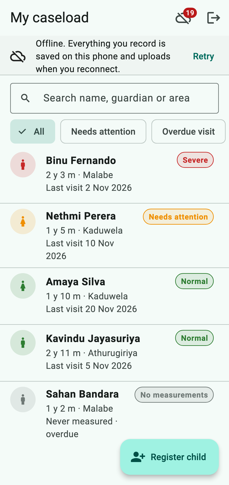
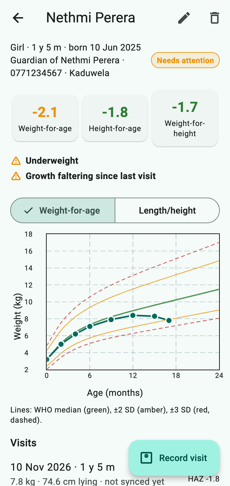
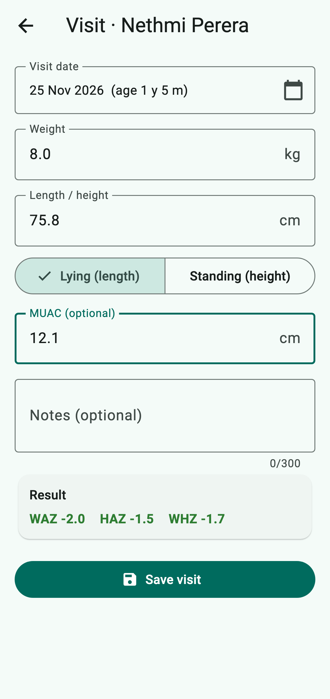
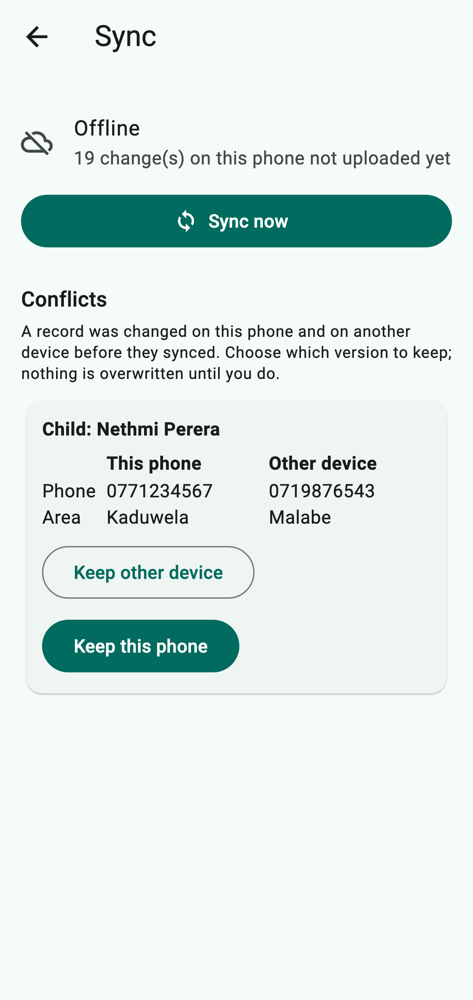

# Child Growth Monitor

[](https://github.com/naweedhah/child-growth-monitor/actions/workflows/ci.yml)

An offline-first Flutter app for public health midwives who track the growth of children under five. A
midwife records a child's weight, length/height and MUAC at a clinic or home visit, even without a signal;
the app computes **WHO Child Growth Standards z-scores on the phone**, flags stunting, wasting, underweight
and growth faltering, plots the child on WHO growth curves, and syncs the caseload through Firebase when a
connection is available, with **conflict detection** when the same record was changed on two devices.

It grew out of my final-year research on [childhood malnutrition risk models](https://github.com/naweedhah/malnutrition-model):
the research monitors a model's data; this app is the field tool that collects that kind of data reliably.

**Stack:** Flutter 3.50 · Dart 3.14 · Riverpod 3 · go_router · Drift (SQLite) · Firebase Auth · Cloud Firestore ·
fl_chart · connectivity_plus · flutter_test + fake_cloud_firestore + firebase_auth_mocks · GitHub Actions (APK build)

| Caseload | Child profile | Record a visit | Sync conflict |
| --- | --- | --- | --- |
|  |  |  |  |

*Screenshots are rendered from the real widgets with demo data by `tool/screenshots_test.dart`.*

## Features

- **Caseload** sorted by urgency, with search and filters for "needs attention" and "overdue visit" (no
  growth check in 60 days)
- **Child profile:** latest weight-for-age, height-for-age and weight-for-height z-scores, findings
  (e.g. *Severe wasting (SAM): refer for treatment*), MUAC screening, visit history
- **Growth charts:** weight-for-age and length/height-for-age against WHO median, ±2 SD and ±3 SD curves
- **Record a visit:** z-scores and findings preview live while typing; lying/standing defaults by age;
  biologically implausible results must be confirmed ("75 kg? did you mean 7.5?")
- **Works offline:** every read and write goes to the on-device database; changes upload automatically
  when the phone reconnects, a few seconds after an edit, or on pull-to-refresh
- **Sync screen:** pending changes, last sync, and side-by-side conflict resolution
- Firebase email/password sign-in; each health worker gets a separate local database and only sees
  their own caseload

## How the growth maths works

`lib/growth/` is plain Dart with no Flutter dependency.

- The **LMS method**: `z = ((y / M)^L − 1) / (L·S)`, using WHO's L, M and S parameters by sex and **age in
  days** (or by length/height in 0.1 cm steps, interpolated in between). The tables in `assets/who/` come
  unmodified from WHO's official `anthro` package ([details and licence](assets/who/README.md)).
- For weight-based indicators beyond ±3 SD, WHO's **restricted** calculation is used (distance past 3 SD
  measured in units of the 2–3 SD gap), as WHO Anthro does.
- **Length vs height:** under 2 years children are measured lying; a standing measurement gets +0.7 cm,
  and from 2 years a lying measurement gets −0.7 cm. Weight-for-length is used under 2 years and
  weight-for-height from 2 years.
- **Classification:** z < −2 moderate and < −3 severe for stunting (HAZ), wasting (WHZ) and underweight (WAZ);
  WHZ > 2 overweight; a WAZ drop of more than 0.67 SD between visits (crossing a major centile line)
  is flagged as **growth faltering**, often the earliest warning.
- **Plausibility flags** follow WHO's cut-offs (WAZ < −6 or > 5, HAZ ±6, WHZ ±5).
- Tested against WHO's published SD charts: e.g. for a 12-month-old girl, 6.3 / 7.0 / 7.9 / 8.9 / 10.1 /
  11.5 / 13.1 kg come out at −3 … +3 SD.

## How offline sync works

The phone's **Drift (SQLite) database is the source of truth for the UI**; Firestore is the shared copy.
Firestore's own offline cache is turned off so the two never disagree about what is "local".

| Problem | Design |
| --- | --- |
| Two devices edit the same child while offline | Every record carries the server `version` it was based on. A push runs in a **Firestore transaction** that only writes if the server is still at that version (optimistic concurrency), then increments it. Otherwise nothing is written and the record becomes a **conflict** that the health worker resolves (keep this phone / keep the other device). Nothing is overwritten silently ([`SyncEngine`](lib/sync/sync_engine.dart)) |
| The same edit made on both phones | Detected by comparing content and resolved automatically |
| User edits a record while its upload is in flight | The upload only clears the `dirty` flag if `updatedAt` hasn't changed since, so the newer edit is still uploaded |
| Device clocks are wrong | Pull order and the pull cursor use Firestore **server timestamps**, never the phone's clock. The cursor is inclusive and already-applied versions are skipped, so writes in the same timestamp tick are not missed |
| Deleted records reappearing | Deletes are **tombstones** (`deleted = true`) that sync like any other change |
| A measurement arriving before its child | Children are pushed and pulled before measurements |
| Data isolation | Firestore paths are `users/{uid}/…`; [security rules](firestore.rules) only allow a user their own data, require `version` to increase by exactly one and the server timestamp to be the request time, and forbid hard deletes |
| Testable sync | The engine talks to a small `RemoteStore` interface. Tests run **two simulated phones** (two in-memory databases) against one fake Firestore to exercise conflicts, resolutions, tombstones and cursors |

## Validation

Field forms validate as you type ([`validation.dart`](lib/growth/validation.dart)): names in Sinhala, Tamil
or English script, 10-digit Sri Lankan phone numbers, dates of birth within the 0–60 month range of the WHO
standards, visit dates between birth and today, and weight (0.5–40 kg), length/height (38–130 cm) and MUAC
(5–30 cm) ranges that catch decimal-point typos. A comma works as the decimal separator. The database also
enforces constraints (sex and position enums, a measurement must have a weight or a height).

## Project structure

```
lib/
  growth/      WHO LMS z-scores, classification, field validation (pure Dart)
  data/        Drift schema (children, measurements, conflicts, sync metadata) and repository
  sync/        RemoteStore interface, Firestore implementation, sync engine
  ui/          screens: sign-in, caseload, child profile + growth chart, visit form, sync/conflicts
  providers.dart  Riverpod wiring, sync controller (connectivity, debounce, manual)
assets/who/    WHO growth-standard LMS tables
test/          unit, sync (two-device) and widget tests
tool/          screenshot renderer
firestore.rules, firebase.json   security rules and emulator config
```

## Run it

Requirements: Flutter 3.50, an Android emulator or device (iOS needs Xcode), and the
[Firebase CLI](https://firebase.google.com/docs/cli) for the local emulators.

```bash
flutter pub get
firebase emulators:start            # Auth + Firestore emulators (project demo-growth-monitor), UI at localhost:4000
flutter run                         # Android emulator reaches the host's emulators at 10.0.2.2
```

On a physical phone, pass your computer's LAN IP: `flutter run --dart-define=EMULATOR_HOST=192.168.1.20`
(and allow that address in `android/app/src/main/res/xml/network_security_config.xml`).
Create an account on the sign-in screen; then try turning on airplane mode, recording visits, and turning
it off again.

**Real Firebase project:** run `flutterfire configure` (replaces `lib/firebase_options.dart`), deploy the
rules with `firebase deploy --only firestore:rules`, and build with
`--dart-define=USE_FIREBASE_EMULATOR=false`.

## Tests

```bash
flutter test      # 38 tests
```

- **WHO maths:** LMS round-trips, the restricted method beyond ±3 SD, WHO's published SD values, the
  0.7 cm lying/standing correction, table selection by age, interpolation, range errors, plausibility flags
- **Classification:** severe/moderate findings, SAM referral, growth faltering
- **Sync:** two phones against a fake Firestore: propagation, per-user isolation, conflict detection,
  keep-mine and keep-theirs, identical edits, tombstones, edits during an upload, the pull cursor
- **Widgets:** sign-in validation, urgency ordering and filters, recording a visit with live z-scores,
  implausible-value confirmation, inline range errors, offline queueing, upload when online
- **Validation:** names in three scripts, phones, dates, measurement ranges

CI runs `flutter analyze` and the tests, checks the generated Drift code is current, and builds a release
APK (downloadable from each run's artifacts).

## Notes

- This is a portfolio project, not a certified medical device. Clinical decisions should follow the
  national child health guidelines.
- WHO growth-standard data: WHO Multicentre Growth Reference Study Group (2006), via WHO's `anthro` package
  (GPL-3.0); see [assets/who/README.md](assets/who/README.md).
